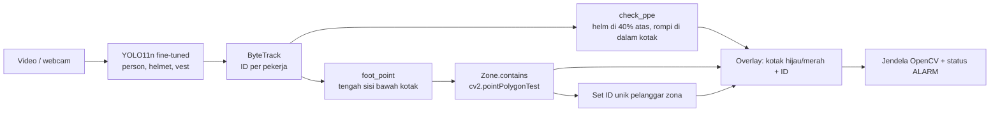

# Arsitektur

| File | Peran |
|---|---|
| `src/detector.py` | wrapper YOLO + tracker, aturan APD |
| `src/geofence.py` | poligon zona dan titik kaki |
| `app.py` | loop video, gambar overlay dan alarm |
